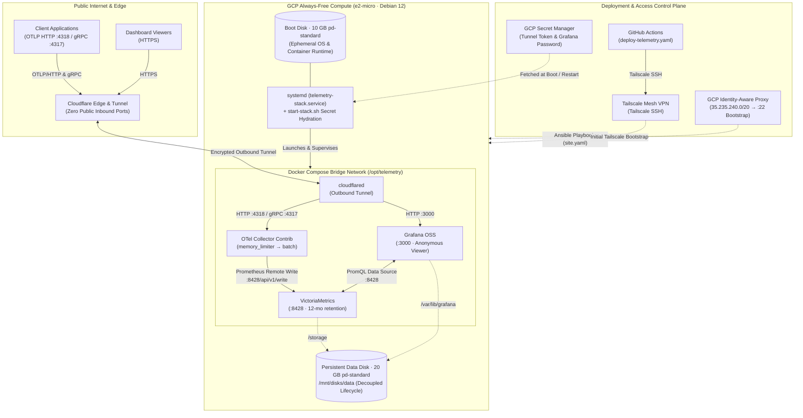

# Observability Stack on GCP (Always Free Tier)

A self-bootstrapping, low-cost observability pipeline deployed on a Google Cloud Platform (GCP) `e2-micro` VM running Debian 12. Infrastructure is provisioned with **OpenTofu**, host configuration is managed with **Ansible**, runtime secrets are fetched from **Google Secret Manager**, and all services run via **Docker Compose** behind an outbound **Cloudflare Tunnel**.

## Architecture & Design Overview

The architecture separates **public ingress**, **secret hydration**, and **administrative access** into distinct boundaries while staying strictly within GCP's Always-Free compute (`e2-micro`, 1 GB RAM) and storage (`30 GB pd-standard` total) limits.



### Key Architectural Decisions

* **Zero-Cost Always-Free Footprint:** Sized to fit inside GCP's perpetual free tier (`e2-micro` with 1 GB RAM and a 10 GB boot / 20 GB data `pd-standard` disk split) without triggering billing charges.
* **VictoriaMetrics over Prometheus:** Uses single-node VictoriaMetrics (`~35–60 MB` idle footprint) instead of standard Prometheus (`~150–300 MB+`) to preserve headroom under the 1 GB host ceiling while keeping full PromQL compatibility.
* **Zero-Trust Outbound Ingress (`cloudflared`):** Routes public OTLP (`:4317` gRPC / `:4318` HTTP) and Grafana (`:3000`) traffic through an encrypted outbound Cloudflare Tunnel, eliminating public firewall openings.
* **Decoupled Persistent Storage:** Separates stateless compute (10 GB boot disk) from time-series blocks and dashboard state (20 GB disk mounted at `/mnt/disks/data`), allowing full VM rebuilds without data loss.
* **Runtime Secret Hydration:** Fetches the Cloudflare Tunnel token and Grafana admin password from Google Secret Manager via `start-stack.sh` at `systemd` startup—no secrets are committed to Git or baked into disk images.

*For full component breakdowns, memory budgets, and technology comparisons, see [`docs/architecture.md`](docs/architecture.md).*

### Stack Layers

* **OpenTofu (`terraform/`)**: Provisions the `e2-micro` GCE instance, decoupled 20 GB `pd-standard` persistent disk, dedicated runtime service account, Google Secret Manager secret resources and IAM bindings, a GCS state bucket, and an IAP-only SSH firewall rule.
* **Ansible (`ansible/`)**: Formats and mounts `/mnt/disks/data`, installs Tailscale (with Tailscale SSH) and Docker CE, deploys the telemetry configuration files, and configures `telemetry-stack.service`.
* **Telemetry Stack (`otel-collector/`)**: Runs `cloudflared`, `otel-collector-contrib` (`memory_limiter` + `batch` processors), `victoria-metrics` (`:8428`), and `grafana` (`:3000`) with strict container memory limits.

---

## Required Google Secret Manager Secrets

OpenTofu creates the secret containers in Google Secret Manager and grants `roles/secretmanager.secretAccessor` to the VM's service account (`otel-collector-sa`). Before starting the stack, you must add a secret version to each secret:

| Secret Variable / Placeholder | Description | Expected Payload Format |
| :--- | :--- | :--- |
| `CLOUDFLARE_TUNNEL_SECRET_ID` (e.g., `cloudflare-tunnel-token`) | Token for `cloudflared` from the Cloudflare Zero Trust Dashboard | Raw plain-text tunnel token string (no trailing newline) |
| `GRAFANA_ADMIN_PASSWORD_SECRET_ID` (e.g., `grafana-admin-password`) | Password for the Grafana `admin` user | Raw plain-text password string (no trailing newline) |

Example commands to populate secret versions:

```bash
printf '%s' 'CLOUDFLARE_TUNNEL_TOKEN' | gcloud secrets versions add CLOUDFLARE_TUNNEL_SECRET_ID --data-file=-
printf '%s' 'GRAFANA_ADMIN_PASSWORD' | gcloud secrets versions add GRAFANA_ADMIN_PASSWORD_SECRET_ID --data-file=-
```

At runtime, `/opt/telemetry/start-stack.sh` (rendered from `ansible/templates/start-stack.sh.j2`) retrieves an OAuth token from the GCE instance metadata server and fetches the latest version of each secret directly from the Secret Manager REST API.

---

## Configuration & `.example` Files

Before deploying, copy and customize the provided `.example` templates and replace all placeholders:

1. **OpenTofu Backend (`terraform/main.tf`)**:
   - Replace `TF_STATE_BUCKET` with your globally-unique GCS bucket name (or pass `-backend-config="bucket=..."` during `tofu init`).
2. **OpenTofu Variables (`terraform/terraform.tfvars.example` -> `terraform/terraform.tfvars`)**:
   - Copy `terraform/terraform.tfvars.example` to `terraform/terraform.tfvars` and set `project_id`, `region`, `zone`, `tf_state_bucket_name`, `tunnel_secret_id`, and `grafana_secret_id`.
3. **Ansible Inventory (`ansible/hosts.yaml.example` -> `ansible/hosts.yaml`)**:
   - Copy `ansible/hosts.yaml.example` to `ansible/hosts.yaml` and set `ansible_host` and `ansible_user`.
4. **Ansible Playbook Vars (`ansible/site.yaml`)**:
   - Update `gcp_project_id`, `tunnel_secret_id`, and `grafana_secret_id` under `vars:` to match your GCP project and Secret Manager secret IDs.
5. **Domains & CORS (`otel-collector/`)**:
   - In `otel-collector/docker-compose.yml`, update `GF_SERVER_ROOT_URL` to your Grafana public URL (e.g., `https://grafana.example.com`).
   - In `otel-collector/otel-collector-config.yaml`, update `receivers.otlp.protocols.http.cors.allowed_origins` with your allowed client origins.
6. **Optional `.env` Reference (`.env.example`)**:
   - Provided for local testing with `docker compose` if not running via `start-stack.sh`.
7. **GitHub Actions Workflow (`.github/workflows/deploy-telemetry.yaml.example` -> `.github/workflows/deploy-telemetry.yaml`)**:
   - Copy `.github/workflows/deploy-telemetry.yaml.example` to `.github/workflows/deploy-telemetry.yaml` to enable automated deployments.
   - Configure repository secrets `TS_OAUTH_CLIENT_ID` and `TS_OAUTH_SECRET`, and repository variables `VM_TAILSCALE_HOST` and `VM_SSH_USER` (used to generate `ansible/hosts.yaml` at runtime).

---

## Deployment Quickstart

1. **Provision Infrastructure with OpenTofu**:
   ```bash
   cd terraform
   tofu init
   tofu apply
   ```
2. **Populate Secret Manager Versions** (see commands above).
3. **Bootstrap Tailscale on the New VM** (once per VM via IAP SSH):
   ```bash
   gcloud compute ssh otel-collector-vm --zone=GCP_ZONE --tunnel-through-iap
   curl -fsSL https://tailscale.com/install.sh | sh && sudo tailscale up --ssh
   ```
4. **Configure & Start the Stack with Ansible**:
   ```bash
   cd ansible
   ansible-galaxy collection install -r requirements.yaml
   ansible-playbook site.yaml
   ```
5. **Verify Services**:
   ```bash
   ssh SSH_USER@VM_HOST "docker ps"
   ```

## Pipeline Verification (Smoke Test)

Use `scripts/smoke-test.sh` to verify end-to-end metric ingestion from the OTel Collector (`:4318`) into VictoriaMetrics (`:8428`). The script sends a unique OTLP/HTTP metric payload and polls VictoriaMetrics until the batched data point appears in storage.

1. **Make the script executable** (first time only):
   ```bash
   chmod +x scripts/smoke-test.sh
   ```

2. **Run over Tailscale SSH against the deployed VM**:
   ```bash
   ssh SSH_USER@VM_HOST 'bash -s' < scripts/smoke-test.sh
   ```

3. **Test public Cloudflare Tunnel ingress** (optional, run locally while forwarding `:8428` or directly on the VM):
   ```bash
   OTEL_ENDPOINT=https://otel.example.com ./scripts/smoke-test.sh
   ```
