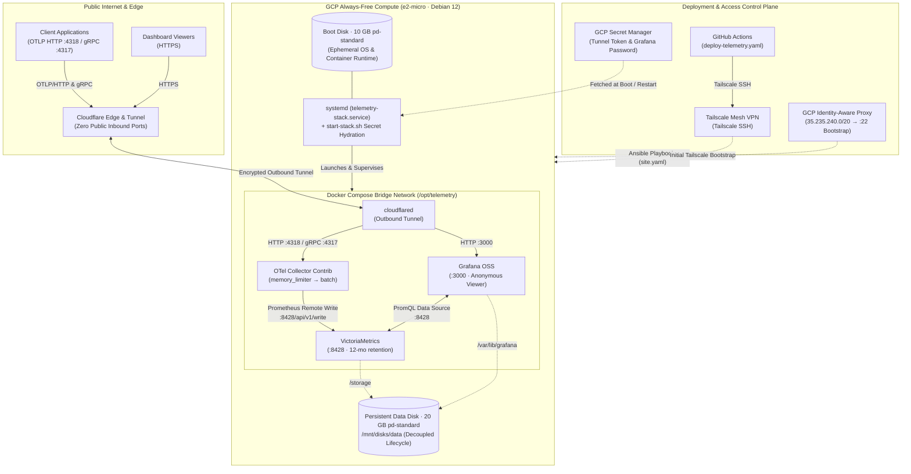

# Architecture Specification: Shared Observability Pipeline

## 1. Overview & Constraints

This specification outlines the centralized, zero-cost observability stack hosted on an Always-Free Google Cloud Platform (GCP) `e2-micro` virtual machine running Debian 12. The architecture provides persistent metric collection, long-term time-series storage, and dashboard visualization without recurring infrastructure fees or SaaS retention cutoffs.

### Core Hard Constraints
* **Compute Limit:** GCP Always-Free `e2-micro` (2 shared vCPUs, 1.0 GB RAM) running in a permitted US region (`us-central1`, `us-east1`, or `us-west1`).
* **Storage Limit:** 30 GB total Standard Persistent Disk (`pd-standard`), split into a 10 GB boot disk and a 20 GB decoupled data disk. *Note: `pd-balanced` or `pd-ssd` volumes trigger billing charges.*
* **Cost:** Guaranteed $0 perpetual runtime.
* **Durability:** Metrics and dashboard state must survive VM reboots, kernel updates, and full instance replacements.

---

## 2. Architecture & Data Flow

### Data Path Walkthrough
1. **Zero-Trust Ingress (`cloudflared`):** All external traffic enters through Cloudflare Edge and traverses an encrypted outbound tunnel maintained by `cloudflared`, eliminating the need for a static public IP or open HTTP/HTTPS firewall ports.
2. **Telemetry Ingestion:** Client applications push OTLP metrics over gRPC (`:4317`) or HTTP (`:4318`) to the OpenTelemetry Collector.
3. **Buffer & Batch:** The collector's `memory_limiter` and `batch` processors cap memory growth and group records into bulk flushes before export.
4. **Time-Series Storage:** The collector uses the `prometheusremotewrite` exporter to push metric batches directly into VictoriaMetrics on port `:8428`, which writes compressed blocks to `/mnt/disks/data/victoriametrics`.
5. **Visualization:** Grafana communicates with VictoriaMetrics over the internal Docker bridge network using a pre-provisioned Prometheus-compatible datasource (`otel-collector/victoriametrics-datasource.yaml`), persisting dashboards and state to `/mnt/disks/data/grafana`.

---

## 3. Technology Evaluation: VictoriaMetrics vs. Alternatives

VictoriaMetrics replaces standard Prometheus and external managed databases for this single-node deployment:

| Criterion | VictoriaMetrics (Single-Node) | Prometheus Server | Managed SQL / PostgREST |
| :--- | :--- | :--- | :--- |
| **Ingestion Protocol** | Native Prometheus Remote Write (`/api/v1/write`) | Remote Write Receiver (requires extra flags) | Relational SQL / Custom JSON REST |
| **Collector Exporter** | Built-in (`prometheusremotewrite`) | Built-in (`prometheusremotewrite`) | Requires translation layer (Edge Function/Script) |
| **Idle Memory Footprint** | ~35 MB – 60 MB | ~150 MB – 300 MB+ | N/A (External cloud service) |
| **Disk Compression** | Up to 10x vs. raw Prometheus | Standard chunk encoding | High row overhead for time series |
| **Retention Policy** | Configurable via flag (e.g., `-retentionPeriod=12`) | Configurable via retention flags | Storage caps on free tiers |
| **Query Engine** | Drop-in PromQL & MetricsQL support | PromQL | SQL / Timescale |

---

## 4. Container Resource Budget (1.0 GB Host Ceiling)

On an `e2-micro` instance with 1.0 GB of RAM, memory spikes without container caps can trigger the Linux Out-Of-Memory (OOM) killer. Explicit memory ceilings are enforced in `otel-collector/docker-compose.yml` alongside the collector's internal `memory_limiter` processor:

| Container / Process | Baseline RAM | Hard Limit (`mem_limit`) | Role |
| :--- | :--- | :--- | :--- |
| **Host Debian OS + Kernel** | ~100 MB – 140 MB | N/A | Core OS, networking, `systemd`, `tailscaled`, Docker daemon |
| **Cloudflare Tunnel (`cloudflared`)** | ~15 MB – 25 MB | 100 MB | Encrypted outbound ingress proxy for Grafana & OTLP |
| **OpenTelemetry Collector Contrib** | ~40 MB – 60 MB | 250 MB | OTLP gRPC/HTTP receiver, `memory_limiter`, batcher, PRW exporter |
| **VictoriaMetrics** | ~35 MB – 60 MB | 300 MB | Time-series storage engine, PromQL HTTP API |
| **Grafana OSS** | ~80 MB – 120 MB | 300 MB | Web UI, dashboard rendering, query engine |
| **Buffer Headroom** | ~350 MB | N/A | Reserved for Linux page cache, ingestion bursts, and SSH sessions |

---

## 5. Persistence, Security & Failure Recovery

1. **Decoupled Compute & Storage:** The `e2-micro` VM and its 10 GB boot disk are treated as disposable. All stateful data resides on the separate 20 GB `pd-standard` disk (`/dev/disk/by-id/google-persistent-data`), formatted and mounted at `/mnt/disks/data` by Ansible. Destroying and recreating the VM re-attaches the existing volume intact.
2. **Runtime Secret Hydration:** Secrets (`CLOUDFLARE_TUNNEL_TOKEN` and `GRAFANA_ADMIN_PASSWORD`) are stored in Google Secret Manager and fetched dynamically at `systemd` service startup via `/opt/telemetry/start-stack.sh` using the VM's least-privilege IAM service account.
3. **Zero Public Attack Surface:** Inbound firewall rules permit SSH solely from GCP Identity-Aware Proxy (`35.235.240.0/20`) for initial Tailscale bootstrap; ongoing configuration management runs over Tailscale SSH via GitHub Actions.
4. **Automatic Service Recovery:** `telemetry-stack.service` supervises the Docker Compose lifecycle on boot, and all containers run with `restart: unless-stopped`.
